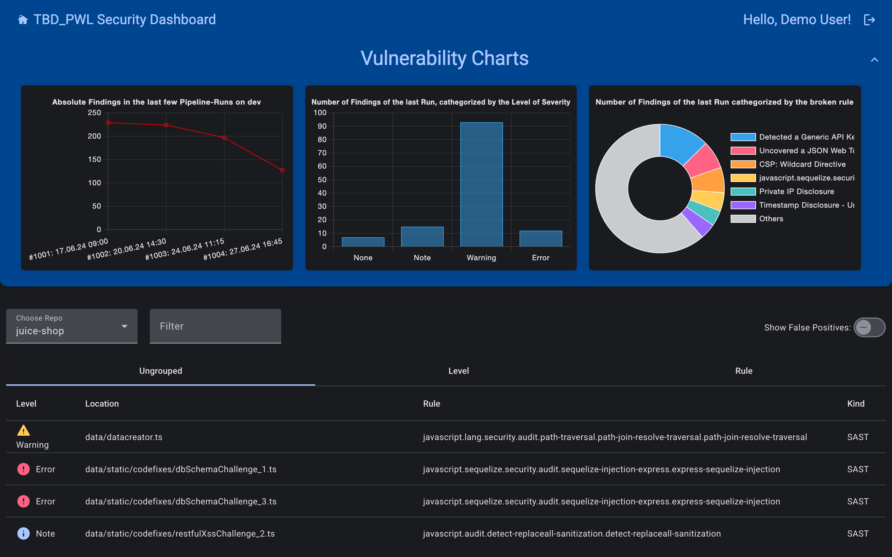
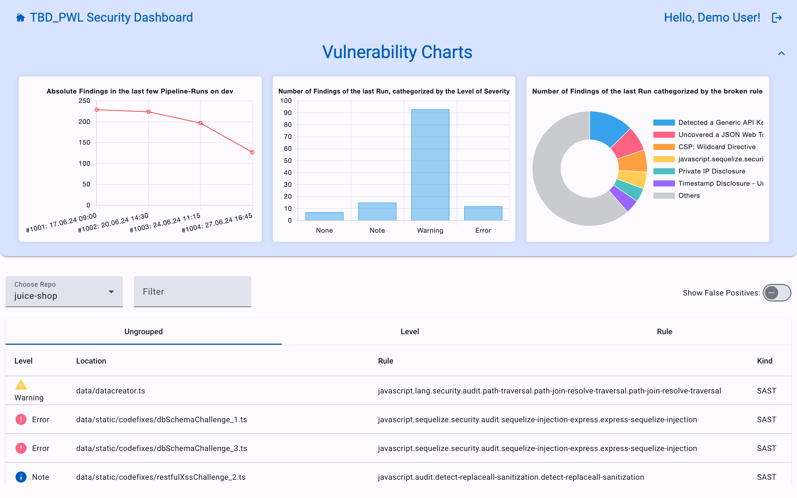
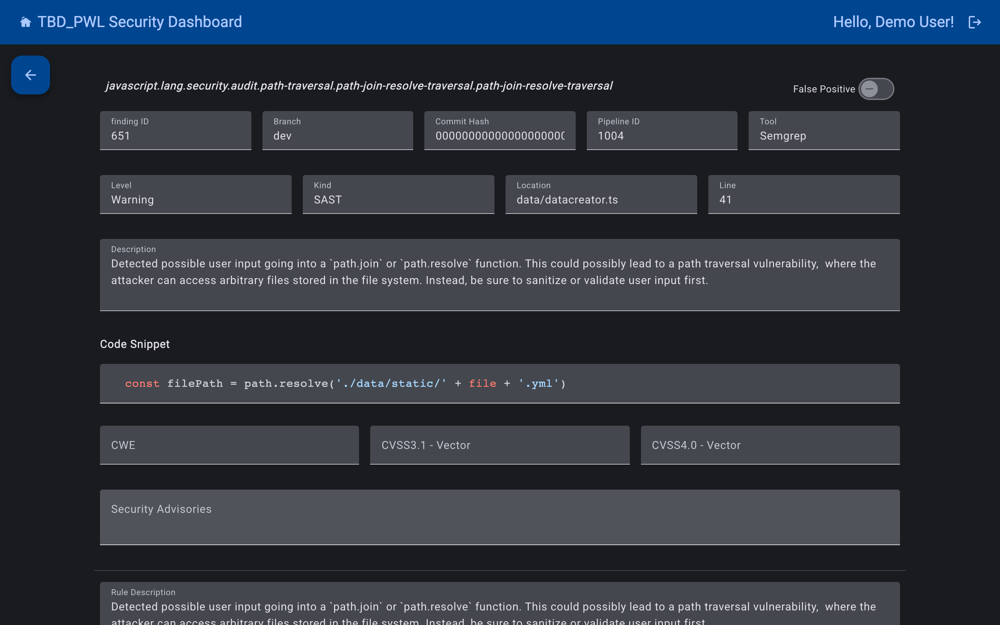

# Security Dashboard (Frontend)

A dashboard that collects the results of the security scanners in a CI pipeline (SAST, secret detection, dependency and container scanning, DAST) and shows them in one place: trends across pipeline runs, findings by severity and rule, and a detail view for each finding.

Built as a six-person team project for the courses *Agile Entwicklungsmethoden* (agile development methods) and *IT-Sicherheit* (IT security) at TH Aschaffenburg (summer semester 2024). This repository contains the Angular frontend; the API lives in [security-dashboard-backend](https://github.com/la-w/security-dashboard-backend).



<details>
<summary>More screenshots</summary>




</details>

## How it fits together

1. A GitLab CI pipeline scans a target project (we used OWASP Juice Shop) with Fluid Attacks, Semgrep, Gitleaks, OWASP Dependency-Check, Trivy and OWASP ZAP.
2. Each tool writes a SARIF report, which the pipeline uploads to the backend.
3. The backend imports the reports, removes duplicate findings and stores them.
4. This frontend shows the results to team members, who log in via GitLab (OIDC). Findings can be marked as false positives.

## Tech stack

Angular 18 (standalone components), Angular Material, Chart.js, highlight.js, `angular-auth-oidc-client`, nginx Docker image, GitLab CI.

## My contributions

- Restructured the app into `components/`, `services/` and a shared Angular Material module, and built the first findings list and detail views (SDO-171).
- Reworked the findings table (SDO-226).
- Reviewed and merged teammates' merge requests for the frontend and backend.

Team: Benjamin Langer, Dominik Orgis, Louis Graßmann, Pascal Schmidt, Tobias Reinhard, Wutthichai Laphutama.

## Running locally

Login originally went through the university's internal GitLab, which is no longer reachable. The `demo` branch adds a demo mode that only applies to the development build and skips the login.

```bash
# 1. Backend: see security-dashboard-backend (demo branch), then seed it with sample data
# 2. Frontend
npm install
npx ng serve --configuration development   # http://localhost:4200
```

The original GitLab CI pipeline (`.gitlab-ci.yml`) targeted the university's infrastructure and is kept for reference only.
